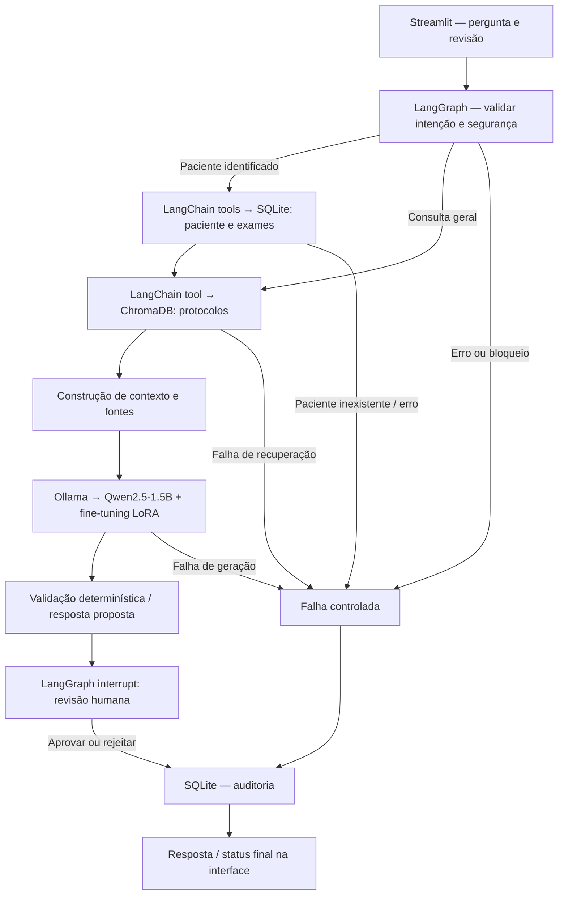

# Hospital Aurora — Assistente Médico com IA

> **FIAP | Pós-graduação em Inteligência Artificial para Desenvolvedores | Tech Challenge — Fase 3**
>
> **Projeto acadêmico com dados sintéticos. Não é um dispositivo médico nem deve ser utilizado para diagnóstico, prescrição ou decisões clínicas reais.**

## Visão geral

O **Hospital Aurora** é um protótipo de assistente virtual para apoiar a consulta a registros clínicos sintéticos e protocolos institucionais. O projeto combina **fine-tuning de uma LLM**, recuperação de documentos (**RAG**), consultas a dados estruturados e orquestração de fluxos com revisão humana.

A aplicação permite:

- Consultar **exames pendentes** de pacientes fictícios registrados no SQLite.
- Recuperar trechos de protocolos internos utilizando busca semântica.
- Produzir rascunhos com o **Qwen2.5-1.5B-Instruct**, personalizado por QLoRA e executado localmente pelo Ollama.
- Impedir que o texto gerado pela LLM substitua os dados estruturados usados nas respostas sobre exames pendentes.
- Bloquear padrões explícitos de pedidos de prescrição e dosagem.
- Submeter respostas elegíveis à **aprovação ou rejeição humana** antes da liberação.
- Registrar resultados, fontes, validações e decisões em um banco de auditoria.

### Escopo do protótipo

As consultas **vinculadas a um paciente** estão limitadas à identificação de exames pendentes. Outras perguntas específicas sobre o paciente são recusadas como intenção não suportada. Perguntas **gerais** sobre os protocolos podem produzir um rascunho da LLM, sujeito à revisão humana e sem garantia de validação clínica automática.

## Arquitetura



**Componentes principais**

| Camada | Tecnologia | Responsabilidade |
|---|---|---|
| Interface | Streamlit | Perguntas, evidências, revisão e histórico da sessão |
| Orquestração | LangGraph | Estado, roteamento, interrupção, retomada e tratamento de falhas |
| Ferramentas | LangChain | Acesso controlado ao repositório de pacientes e à busca de protocolos |
| Dados estruturados | SQLite | Pacientes, condições clínicas e exames sintéticos |
| Recuperação documental | ChromaDB + embeddings Hugging Face | Busca semântica nos protocolos Markdown |
| Geração | Ollama + Qwen personalizado | Rascunhos em linguagem natural a partir do contexto recuperado |
| Auditoria | SQLite | Persistência de resultados, fontes, validação e decisão simulada |

### Ferramentas LangChain

- `get_patient_info(patient_id)`: consulta idade e condições cadastradas.
- `get_pending_exams(patient_id)`: retorna exames com status `pendente`.
- `search_protocols(query)`: recupera trechos de documentos e seus metadados (`protocol_id`, `source`).

As ferramentas diferenciam resultados válidos, registros inexistentes e indisponibilidade da fonte. Não há execução de SQL arbitrário gerado pela LLM.

## Dados e protocolos

O repositório contém **dados fictícios** em `data/synthetic/`:

| Arquivo | Conteúdo |
|---|---|
| `patients.json` | Três pacientes sintéticos, suas condições e exames |
| `hospital_qa.jsonl` | 33 perguntas e respostas institucionais sintéticas |
| `document_templates.json` | Exemplos sintéticos de modelos documentais internos |

Os protocolos utilizados pelo RAG estão em `data/protocols/`:

- **PRT-001:** verificação de exames pendentes.
- **PRT-002:** validação humana e limites de recomendações clínicas.
- **PRT-003:** acompanhamento do diabetes tipo 2, elaborado para demonstração acadêmica e **não validado para uso clínico**.

O estudo de fine-tuning também utiliza o **MedQuAD** como base pública de perguntas e respostas sobre saúde. A preparação, curadoria e separação dos exemplos estão documentadas nos notebooks. Os registros sintéticos não identificam pacientes reais.

## Fine-tuning e exportação do modelo

**Modelo base:** [`Qwen/Qwen2.5-1.5B-Instruct`](https://huggingface.co/Qwen/Qwen2.5-1.5B-Instruct).

**Estratégia:** QLoRA, com carregamento quantizado em 4 bits durante o treinamento no Google Colab (GPU Tesla T4), adaptadores LoRA e treinamento supervisionado sobre pares de pergunta/resposta.

### Pipeline desenvolvido

| Notebook | Etapa |
|---|---|
| `notebooks/01_medquad_exploracao_preprocessamento.ipynb` | Exploração do MedQuAD, limpeza, curadoria e divisão dos dados |
| `notebooks/02_dados_sinteticos_hospital.ipynb` | Geração dos pacientes fictícios, FAQs, protocolos e modelos documentais |
| `notebooks/03_fine_tuning_llm_medica.ipynb` | Preparação dos exemplos, QLoRA, treino, validação e comparação com o modelo base |
| `notebooks/04_exportacao_modelo.ipynb` | Fusão dos pesos LoRA ao Qwen e exportação/quantização em GGUF |

Após a limpeza exploratória do MedQuAD, foram identificados **16.358 pares válidos**. A divisão considerou grupos de documentos e focos de pergunta relacionados para reduzir vazamento entre conjuntos. Para o treinamento final, foi utilizada uma amostra filtrada de **1.556 exemplos de treino** e **144 de validação**, incluindo FAQs sintéticas institucionais com sobreamostragem.

**Resultado registrado na validação do fine-tuning:**

| Métrica | Valor |
|---|---:|
| `eval_loss` | 1,3066 |
| `eval_mean_token_accuracy` | 0,6795 |

Essas métricas medem o desempenho na tarefa de previsão de tokens da validação utilizada; **não representam acurácia clínica, segurança médica ou precisão de respostas sobre pacientes**.

**Distinção importante:** o treinamento final utilizou MedQuAD e exemplos de FAQ institucional. Os protocolos foram integrados à aplicação como base de recuperação (RAG), e os modelos documentais foram preparados como artefatos sintéticos. A presença desses arquivos no projeto **não significa que todos foram incorporados diretamente ao conjunto final de fine-tuning**.

### Modelo de inferência

O adaptador LoRA foi incorporado ao modelo base (`merge_and_unload`) e convertido para **GGUF Q4_K_M**, resultando no arquivo:

`qwen_aurora_q4_k_m.gguf` — aproximadamente **940,37 MB**.

O arquivo GGUF e os demais pesos **não são versionados no Git**, devido ao tamanho. Para reproduzir a inferência, é necessário obter o GGUF com o autor do projeto **ou reproduzir o notebook de exportação após gerar o adaptador de fine-tuning**. Um arquivo no Google Drive privado do autor não constitui um link público de distribuição.

## Requisitos para execução

- Python 3.13 (ambiente local utilizado no desenvolvimento).
- macOS, Linux ou ambiente compatível com as bibliotecas Python; a inferência local deste projeto foi testada em **MacBook Air Apple M1 com 8 GB**.
- [Ollama](https://ollama.com/download) instalado e com o serviço ativo.
- Arquivo `qwen_aurora_q4_k_m.gguf` disponível localmente.
- Internet na primeira indexação, caso o modelo de embeddings ainda não esteja em cache.

> O treinamento não é necessário para **executar** a aplicação se o GGUF personalizado já estiver disponível. Os notebooks de treino e exportação exigem ambiente compatível e dependências próprias (Transformers, PEFT, TRL, PyTorch etc.), separadas das dependências de execução da interface.

## Instalação e execução

Execute os comandos **na raiz do repositório**.

### 1. Criar o ambiente Python

```bash
python3 -m venv .venv
source .venv/bin/activate
python -m pip install -U pip
python -m pip install -r requirements.txt
```

No Windows, a ativação do ambiente virtual é diferente; os comandos acima foram escritos para macOS/Linux.

### 2. Preparar o banco de pacientes

```bash
python -m scripts.seed_database
```

O script utiliza `data/synthetic/patients.json` e o esquema de `src/database/schema.sql`, criando o SQLite local em `data/local/hospital.db`.

### 3. Indexar os protocolos no ChromaDB

```bash
python -m scripts.index_protocols
```

O script carrega os três arquivos Markdown, divide-os em trechos e gera a coleção vetorial em `data/chroma_db/`. O modelo de embeddings configurado é `sentence-transformers/paraphrase-multilingual-MiniLM-L12-v2`.

### 4. Importar o Qwen personalizado no Ollama

Coloque o GGUF no caminho esperado pelo `Modelfile`:

```text
artifacts/gguf/qwen_aurora_q4_k_m.gguf
```

Com o **serviço Ollama ativo**, execute:

```bash
ollama create hospital-aurora -f Modelfile
ollama list
```

O nome `hospital-aurora` é utilizado pelo `OllamaProvider`. O Modelfile define o template de conversação e parâmetros iniciais de inferência.

### 5. Iniciar a interface

```bash
python -m streamlit run app/streamlit_app.py
```

Abra o endereço indicado no terminal (normalmente `http://localhost:8501`). Não é necessário iniciar `ollama run` separadamente; a aplicação conversa com o serviço Ollama local.

### Exemplos de perguntas

```text
Quais exames estão pendentes para o paciente P001?
Quais exames estão pendentes para P002?
Como funciona a validação de recomendações clínicas?
```

Na tela, revise a resposta proposta, os exames registrados e os identificadores de protocolos. A aprovação/rejeição é **simulada para fins acadêmicos**, não corresponde à autenticação de um profissional de saúde.

## Testes e avaliação

### Testes automatizados

```bash
python -m pytest tests/ -v
```

A suíte cobre acesso a dados, ferramentas LangChain, roteamento LangGraph, geração simulada, rejeição/aprovação, bloqueios, validação de dados estruturados e auditoria.

### Avaliação end-to-end

Com Ollama, SQLite e ChromaDB preparados:

```bash
python -m scripts.evaluate_assistant
```

O script executa **15 cenários**, incluindo pacientes com e sem exames pendentes, paciente inexistente, consultas gerais, bloqueio de prescrição, perguntas inválidas e decisões humanas **simuladas**. Os resultados são exportados para `reports/evaluation/`.

**Resultado da avaliação final executada:** **15/15 cenários aprovados (100% de conformidade com as verificações do workflow)**.

Esse indicador **não significa 100% de acurácia médica**. A avaliação inclui critérios como status esperado, bloqueio/roteamento, presença ou ausência de dados estruturados e existência de auditoria; ela não é um benchmark clínico independente.

Para inspecionar rascunhos selecionados do modelo:

```bash
python -m scripts.review_evaluation
```

### Observações qualitativas

- Sem os dados do SQLite, o modelo gerou exames fictícios para um paciente. Com o contexto estruturado, produziu uma resposta correta no caso analisado.
- Na avaliação inicial, houve rascunho inadequado em uma solicitação de prescrição; posteriormente, foi incluído um bloqueio determinístico anterior à geração para padrões explícitos dessa solicitação.
- Respostas gerais podem ser incompletas, imprecisas ou sem fundamentação suficiente. A recuperação vetorial indica **trechos candidatos** e não comprova que a resposta esteja apoiada neles.

As evidências de execução estão preservadas nos arquivos JSON de `reports/evaluation/`.

## Segurança, revisão humana e auditoria

1. **Dados do paciente:** consultas estruturadas usam SQLite. Uma resposta aprovada sobre exames pendentes é construída a partir desses registros, sem reutilizar nomes de exames ou datas inventados pelo rascunho da LLM.
2. **Limites de intenção:** solicitações identificadas de prescrição/dosagem e perguntas específicas de pacientes fora do escopo suportado são bloqueadas antes da geração.
3. **Revisão humana:** respostas elegíveis passam por `interrupt()` no LangGraph e só continuam após `Command(resume=...)`. Na demonstração, a decisão é simulada pelo operador da interface.
4. **Auditoria:** um SQLite independente (`data/local/audit.db`) registra pergunta, identificador da execução, fontes, rascunho, validação, decisão e resultado final. Os eventos usam `request_id` para evitar duplicidade na gravação.
5. **Falhas controladas:** paciente não encontrado, indisponibilidade de dados ou falha de geração retornam status explícitos, em vez de informações inventadas.

### Limitações conhecidas

- **Não adequado para uso clínico real:** protocolos e registros são sintéticos ou demonstrativos, sem homologação clínica.
- O bloqueio de prescrição usa padrões determinísticos e **não detecta necessariamente todas as variações possíveis** de pedidos de tratamento.
- Respostas gerais mantêm validação automática limitada; a revisão humana simulada não substitui a avaliação clínica real.
- O `InMemorySaver` mantém revisões pendentes somente durante a sessão/processo. A auditoria final é persistida, mas a fila de aprovações pendentes não é durável.
- O histórico da interface é da sessão atual, enquanto o banco de auditoria é local.
- Não foram implementados autenticação, autorização, criptografia e governança de dados necessários em um ambiente hospitalar real.
- Os pesos do modelo são distribuídos separadamente, e o funcionamento completo depende de sua disponibilidade.

## Estrutura do repositório

```text
app/                     Interface Streamlit
artifacts/               Pesos e GGUF locais — ignorados pelo Git
data/local/              Bancos SQLite locais — ignorados pelo Git
data/chroma_db/          Índice vetorial local — ignorado pelo Git
data/protocols/          Protocolos sintéticos PRT-001 a PRT-003
data/synthetic/          Pacientes fictícios, FAQs e modelos documentais
notebooks/               Exploração, dados, fine-tuning e exportação
src/audit/               Persistência e nó de auditoria
src/database/            Conexão, esquema e repositório SQLite
src/graph/               Estado, regras, nós e workflow LangGraph
src/llm/                 Provedores de inferência; Ollama em uso na aplicação
src/rag/                 Leitura de protocolos, embeddings e ChromaDB
src/tools/               Ferramentas LangChain
scripts/                 Seed, indexação, execução e avaliação
tests/                   Testes automatizados
reports/evaluation/      Relatórios JSON de avaliação
Modelfile                Configuração de importação/inferência no Ollama
requirements.txt         Dependências da aplicação e dos testes
```

## Entregáveis da Fase 3

Este repositório contempla o código modular da aplicação, os notebooks do pipeline de treinamento, os exemplos de dados sintéticos, a integração LangChain/LangGraph, as políticas de segurança e as evidências de avaliação. O **relatório técnico detalhado**, com análise dos resultados e diagrama, e o **vídeo de demonstração (até 15 minutos)** complementam a entrega conforme o enunciado da FIAP.

## Download do modelo

O modelo personalizado do Hospital Aurora está disponível
na seção Releases deste repositório.

**Versão:** v1.0.0
**Arquivo:** [qwen_aurora_q4_k_m.gguf](https://github.com/AndreVicenteW/tech-challenge-fase3/releases/download/v1.0.0/qwen_aurora_q4_k_m.gguf)
**Quantização:** Q4_K_M

Para executar:

1. Baixe o arquivo GGUF da release.
2. Coloque-o em `artifacts/gguf/`.
3. Instale e inicie o Ollama.
4. Execute:

   ollama create hospital-aurora -f Modelfile

5. Inicie a aplicação:

   python -m streamlit run app/streamlit_app.py

O modelo é experimental e não deve ser utilizado
para decisões clínicas reais.

## Referências

- Enunciado — FIAP Tech Challenge, Fase 3 (PDF disponibilizado no ambiente acadêmico).
- [Qwen2.5-1.5B-Instruct](https://huggingface.co/Qwen/Qwen2.5-1.5B-Instruct)
- [MedQuAD no Hugging Face](https://huggingface.co/datasets/lavita/MedQuAD)
- [LangChain](https://docs.langchain.com/)
- [LangGraph](https://docs.langchain.com/oss/python/langgraph/overview)
- [Chroma](https://docs.trychroma.com/)
- [Ollama](https://docs.ollama.com/)
- [Streamlit](https://docs.streamlit.io/)

---

**Aviso:** projeto exclusivamente acadêmico. As saídas da IA podem conter erros e não devem ser utilizadas para orientar o atendimento de pacientes reais.
