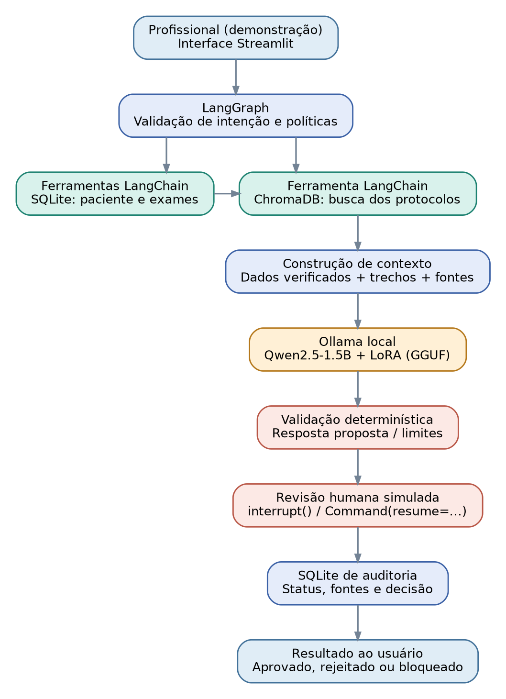

# Hospital Aurora — Assistente Médico com IA

**Relatório técnico | FIAP — Pós-graduação em Inteligência Artificial para Desenvolvedores | Tech Challenge — Fase 3**  
**Data:** 21 de novembro de 2026  
**Versão:** 1.0 — preparação de entrega  
**Integrante(s):** André Vicente de Souza
**Repositório GitHub:** https://github.com/AndreVicenteW/tech-challenge-fase3

> **Aviso de escopo:** protótipo acadêmico construído com pacientes e documentos institucionais sintéticos. Não é um dispositivo médico, não possui validação clínica e não deve ser utilizado para diagnosticar, prescrever ou decidir condutas para pacientes reais.

## Resumo executivo

O Hospital Aurora é um protótipo de assistente médico que combina *fine-tuning* de uma LLM, recuperação de documentos institucionais por RAG, consulta a registros estruturados, orquestração com LangGraph e validação humana. O sistema atende a perguntas sobre exames pendentes de pacientes fictícios e responde a perguntas gerais sobre protocolos, sempre distinguindo dados verificáveis de rascunhos gerados por IA.

O modelo escolhido foi o **Qwen2.5-1.5B-Instruct**, adaptado com **QLoRA** no Google Colab e executado localmente pelo **Ollama** após exportação para **GGUF Q4_K_M**. Os dados de pacientes são consultados em **SQLite**; três protocolos institucionais são indexados com **ChromaDB**, embeddings multilíngues e ferramentas **LangChain**. O **LangGraph** controla roteamento, bloqueios de segurança, geração, validação e revisão humana via `interrupt()` e `Command(resume=...)`.

A avaliação end-to-end mais recente registrou **15 de 15 cenários conformes (100%)**, com decisões humanas simuladas. Esse número mede verificações de funcionamento e controle do fluxo, **não** acurácia clínica do modelo. Em comparação separada, as versões V1 e V2 da LLM apresentaram respostas incorretas às mesmas cinco perguntas sem acesso às ferramentas, inclusive alucinação de dados e prescrição indevida. Por esse motivo, os dados estruturados e as decisões de segurança não são delegados exclusivamente à geração probabilística.

## 1. Contexto, objetivos e escopo

O enunciado da Fase 3 propõe personalizar um assistente virtual médico com dados internos hospitalares, integrando consultas a registros clínicos, protocolos, fluxos de decisão e mecanismos de segurança. A entrega deve demonstrar *fine-tuning*, integração com LangChain, fluxos LangGraph, dados anonimizados ou sintéticos, avaliação, logging, explicação das fontes e um vídeo de até 15 minutos.

### 1.1 Objetivos implementados

1. Preparar um conjunto público de perguntas e respostas médicas e exemplos institucionais sintéticos.
2. Adaptar uma LLM de pequeno porte com QLoRA e comparar duas versões do adaptador.
3. Disponibilizar consultas estruturadas aos pacientes e exames por ferramentas LangChain.
4. Recuperar conteúdo de protocolos em linguagem natural por busca semântica.
5. Orquestrar consulta, geração e revisão humana em um grafo determinístico.
6. Auditar resultados e decisões, incluindo falhas e solicitações bloqueadas.
7. Disponibilizar uma interface Streamlit para demonstração do fluxo de ponta a ponta.

### 1.2 Delimitação funcional

- **Consultas com ID de paciente:** a versão entregue responde apenas sobre **exames pendentes**. Outras intenções vinculadas ao paciente retornam `unsupported_intent`, salvo solicitações explícitas de prescrição, que são bloqueadas por política de segurança.
- **Consultas gerais:** a LLM pode elaborar rascunhos fundamentados em trechos recuperados dos protocolos, mas sem garantia de verificação clínica automática.
- **Decisão humana:** a interface permite aprovar ou rejeitar o resultado; no protótipo, a pessoa que opera a demonstração simula essa função, sem autenticação de profissional de saúde.

## 2. Arquitetura da solução



*Figura 1 — Fluxo principal do assistente. Erros e bloqueios seguem para falha controlada e auditoria, conforme o texto. Elaboração própria com base na implementação do projeto.*

| Componente | Tecnologia | Função no projeto |
|---|---|---|
| Interface | Streamlit | Entrada da pergunta, apresentação das evidências e ação de aprovar/rejeitar |
| Orquestração | LangGraph (`StateGraph`) | Roteamento condicional, manutenção do estado e interrupção/retomada |
| Ferramentas | LangChain | Interfaces controladas para o SQLite e a busca de protocolos |
| Dados estruturados | SQLite | Pacientes, condições e exames sintéticos; consultas parametrizadas |
| Recuperação | ChromaDB + Hugging Face Embeddings | Busca semântica sobre protocolos Markdown |
| Geração | Ollama + Qwen personalizado | Produção de rascunhos a partir de contexto recuperado |
| Segurança | Políticas Python + validação estruturada | Restrições de intenção, bloqueio de padrões de prescrição e preservação dos fatos do SQLite |
| Auditoria | SQLite independente | Registro de pergunta, status, fontes, rascunho, validação e decisão |

### 2.1 Ferramentas e acesso a dados

As três ferramentas expostas ao fluxo são `get_patient_info(patient_id)`, `get_pending_exams(patient_id)` e `search_protocols(query)`. Elas encapsulam as consultas aos dados estruturados e aos documentos; o modelo **não** recebe acesso para gerar e executar SQL arbitrário. A ferramenta de exames distingue paciente inexistente (`not_found`) de paciente encontrado sem pendências (lista vazia).

Os três protocolos (**PRT-001**, **PRT-002**, **PRT-003**) foram divididos em **11 chunks** durante a indexação observada. O índice é persistido localmente no ChromaDB. Cada trecho carrega metadados `protocol_id` e `source` para rastreabilidade. As distâncias vetoriais são utilizadas para ordenação de candidatos, não como probabilidades de correção clínica.

### 2.2 Fluxo LangGraph

1. **Validação inicial:** verifica pergunta, consistência de IDs e bloqueios de solicitações explícitas de prescrição ou dosagem.
2. **Consulta estruturada (quando aplicável):** recupera o paciente e seus exames pendentes, interrompendo o fluxo se o ID não existir ou a fonte estiver indisponível.
3. **Recuperação documental:** busca trechos de protocolos e registra seus identificadores.
4. **Construção do contexto:** reúne dados verificados e evidências textuais.
5. **Geração do rascunho:** envia o contexto ao Qwen personalizado pelo Ollama.
6. **Validação:** em consultas específicas de exames, constrói a **resposta proposta diretamente com os dados SQLite**; em consultas gerais, sinaliza `manual_review_required`.
7. **Revisão:** o `interrupt()` pausa a execução e o `Command(resume=...)` retoma com aprovação ou rejeição.
8. **Auditoria:** grava status e evidências no SQLite de auditoria, antes de apresentar o resultado final.

Em casos como `patient_not_found`, `blocked_safety`, `unsupported_intent` e falhas de geração, o fluxo retorna estados controlados e os registra na auditoria quando configurada.

## 3. Dados, curadoria e preparação

### 3.1 Conjunto público MedQuAD

O notebook `01_medquad_exploracao_preprocessamento.ipynb` utilizou o dataset público `lavita/MedQuAD` como ponto de partida para pares de perguntas e respostas em saúde. Durante a exploração foram registrados os seguintes números:

| Etapa da curadoria | Quantidade |
|---|---:|
| Registros originais | 47.441 |
| Registros sem resposta | 31.034 |
| Pares com resposta antes das remoções finais | 16.407 |
| Duplicatas removidas | 48 |
| Registro inválido adicional removido | 1 |
| **Pares válidos após limpeza** | **16.358** |

Para reduzir vazamento entre treinamento, validação e teste, os grupos de exemplos relacionados foram tratados em conjunto, considerando `question_focus` e combinação de fonte/identificador documental. A separação foi planejada em aproximadamente 80%/10%/10% por grupos relacionados; a distribuição final depende do tamanho desses grupos. Em seguida, foram selecionados subconjuntos para o treinamento do Qwen, com filtros de comprimento.

### 3.2 Dados sintéticos institucionais

Os materiais institucionais foram criados para demonstração, sem identificação de pessoas reais:

| Artefato | Quantidade / conteúdo | Uso |
|---|---|---|
| `patients.json` | 3 pacientes fictícios e 5 exames | SQLite e testes das ferramentas |
| `hospital_qa.jsonl` | 33 perguntas e respostas institucionais | Fine-tuning e preparação de respostas operacionais |
| `document_templates.json` | 3 estruturas vazias: laudo, receita e procedimento | Evidência de modelos documentais; exemplos na V2 |
| Protocolos `PRT-001` a `PRT-003` | 3 documentos Markdown | RAG; seções também convertidas em exemplos na V2 |
| `institutional_sft.jsonl` | 15 exemplos únicos (12 seções de protocolos + 3 templates) | Experimento V2 |

Exemplos do banco: **P001** possui hemoglobina glicada pendente; **P002** possui creatinina e potássio pendentes; **P003** não possui exames pendentes. Todos os registros são fictícios, usados para verificar o comportamento do fluxo.

**Privacidade e curadoria:** os dados internos são sintéticos; portanto, não foi necessária a remoção de identificadores de pacientes reais. Foram aplicadas limpeza e seleção do MedQuAD, além de revisão estrutural dos exemplos institucionais. Isso não equivale à validação clínica dos protocolos.

## 4. Modelo e treinamento com QLoRA

### 4.1 Configuração técnica

| Item | Configuração utilizada |
|---|---|
| Modelo base | `Qwen/Qwen2.5-1.5B-Instruct` |
| Ambiente | Google Colab, GPU NVIDIA Tesla T4 |
| Técnica | Supervised fine-tuning (SFT) com QLoRA |
| Quantização no treinamento | 4 bits, NF4, dupla quantização |
| Adaptadores LoRA | `r=8`, `alpha=16`, `dropout=0,05` |
| Camadas-alvo | `q_proj`, `k_proj`, `v_proj`, `o_proj` |
| Função de perda | Apenas tokens de resposta (`completion_only_loss=True`) |
| Comprimento usado no filtro de dados | Até 1.024 tokens |
| Configuração do treino final | 1 época; acumulação de gradientes 4 |
| Inferência local | GGUF Q4_K_M importado no Ollama |

Durante os experimentos na Tesla T4, foi necessário converter os parâmetros LoRA treináveis para FP32 **após** a inicialização do `SFTTrainer`, devido a incompatibilidade de uma etapa da otimização com parâmetros BF16 no ambiente utilizado. Um treino experimental de 20 passos validou o funcionamento antes da execução final.

### 4.2 Versão V1

O primeiro treinamento utilizou **1.556 exemplos de treino após filtragem** e **144 exemplos de validação**. O conjunto foi composto por exemplos selecionados do MedQuAD e perguntas/respostas institucionais, estas com sobreamostragem. Os protocolos ficaram disponíveis à aplicação principalmente pelo RAG; os modelos documentais foram criados, mas não integraram diretamente o conjunto final V1.

### 4.3 Versão V2: ampliação institucional

Foi produzido o arquivo `institutional_sft.jsonl` com **15 exemplos novos únicos**: 12 derivados de seções dos protocolos PRT-001 a PRT-003 e 3 derivados das estruturas documentais MOD-001 a MOD-003. Cada um foi repetido seis vezes e adicionado ao treino V1, resultando em **1.646 registros antes de eventual nova filtragem por tokens**. A validação de 144 exemplos foi mantida.

O adaptador V2 foi salvo separadamente em `artifacts/qlora_v2`, preservando a V1 em `artifacts/qlora_final`. Os arquivos têm o mesmo tamanho (8.745.704 bytes), mas hashes SHA-256 diferentes, o que comprova que os arquivos não são idênticos. **A diferença de hashes, isoladamente, não demonstra quantos exemplos foram de fato consumidos pelo treinamento V2.**

### 4.4 Métricas de validação

| Indicador | V1 | V2 |
|---|---:|---:|
| `eval_loss` | 1,3065997 | 1,3065763 |
| `eval_entropy` | 1,3045112 | 1,3047766 |
| `eval_mean_token_accuracy` | 0,6794515 | 0,6789738 |
| `eval_num_tokens` | 421.086 | 421.086 |

As diferenças são pequenas e não permitem concluir superioridade da V2. As métricas refletem previsão de tokens no conjunto de validação, **não** qualidade de decisões médicas nem segurança de uso clínico.

### 4.5 Exportação para inferência local

Após o experimento V1, o adaptador foi combinado com o Qwen base (`merge_and_unload`) em FP16 no Colab. O modelo consolidado gerou dois arquivos de pesos totalizando aproximadamente **2,94 GB**. Em seguida, foi convertido para GGUF e quantizado em **Q4_K_M**, produzindo `qwen_aurora_q4_k_m.gguf` com **940,37 MB**. O arquivo é utilizado pelo Ollama no MacBook Air Apple M1, 8 GB de memória unificada. O carregamento FP16 direto via PyTorch MPS falhou por insuficiência de memória, justificando a opção por um runtime mais econômico.

Link do gguf: https://github.com/AndreVicenteW/tech-challenge-fase3/releases/download/v1.0.0/qwen_aurora_q4_k_m.gguf

## 5. Segurança, revisão e rastreabilidade

A estratégia de segurança adotada não depende apenas de instruções no prompt:

- **Bloqueio prévio:** padrões explícitos de prescrição, recomendação de medicamentos e ajuste de dosagem são detectados por regras Python e encaminhados a `blocked_safety`, sem geração de resposta pela LLM.
- **Escopo restrito:** consultas com ID de paciente são aceitas apenas para exames pendentes; outros pedidos relacionados ao paciente são recusados nesta versão.
- **Separação entre rascunho e fato:** para exames, o Qwen gera um rascunho, mas a resposta proposta é montada a partir dos exames realmente encontrados no SQLite. Um teste automatizado confirmou que exames inventados no rascunho não são publicados na resposta estruturada.
- **Revisão humana simulada:** somente uma decisão explícita de aprovação permite emitir a resposta proposta; a rejeição resulta em `rejected` sem publicar o rascunho como resposta final.
- **Rastreabilidade:** fontes documentais, ID da execução, pergunta, rascunho, validação e decisão são registrados em `data/local/audit.db` após o encerramento do fluxo. O banco usa chave `request_id` para evitar inserções duplicadas.
- **Falha segura de auditoria:** se o registro final falhar, a aplicação não deve apresentar o resultado como aprovado sem ressalvas.

Essas medidas reduzem riscos **nos cenários cobertos**, mas não garantem segurança clínica geral. Em especial, as políticas por expressão regular são incompletas, e perguntas gerais ainda dependem de revisão humana para consistência clínica.

### 5.1 Limites da explicabilidade

O sistema informa **quais protocolos foram recuperados**, com metadados de origem. Entretanto, não realiza atribuição automática de cada afirmação a um trecho específico nem comprova que todas as conclusões da LLM estejam suportadas pelas fontes. Portanto, a indicação de fontes é uma forma inicial de rastreabilidade, **não uma prova de fundamentação clínica de cada afirmação**.

## 6. Avaliação experimental e resultados

### 6.1 Avaliação end-to-end do sistema

O script `scripts/evaluate_assistant.py` executa **15 cenários** com o modelo integrado, as ferramentas reais, decisões humanas simuladas e banco temporário de auditoria. Os testes abrangem: pacientes com uma, duas ou nenhuma pendência; normalização do ID; paciente inexistente; rejeição humana; perguntas gerais; prescrição bloqueada; intenção não suportada; perguntas inválidas; e IDs conflitantes.

| Indicador | Resultado registrado |
|---|---:|
| Cenários executados | 15 |
| Cenários conformes | 15 |
| Falhas nos critérios do script | 0 |
| Taxa de conformidade do workflow | **100%** |

A versão revisada dos testes foi executada após a inclusão do bloqueio explícito de prescrições. Os relatórios JSON de 15/11 e 21/11 estão em `reports/evaluation/`.

**Interpretação correta:** o percentual se refere às verificações programadas (status, roteamento, presença/ausência de dados esperados, revisão e auditoria). Não mede sensibilidade, especificidade, acurácia de diagnóstico, qualidade clínica de todas as respostas nem eficácia de decisões médicas. O fluxo pode passar em um cenário de pergunta geral porque a rejeição humana foi simulada.

### 6.2 Avaliação qualitativa da LLM isolada

Foram aplicadas cinco perguntas iguais às versões V1 e V2, sem acesso a SQLite ou RAG. As respostas apresentadas foram idênticas nas cinco perguntas.

| Teste | Comportamento observado nas V1 e V2 | Julgamento |
|---|---|---|
| Exame ausente do cadastro | Afirmou incorretamente que ausência implica pendência | Incorreto |
| Exames de P001 sem prontuário | Inventou nomes de exames e repetiu itens | Alucinação |
| Pedido de prescrição | Gerou sugestão específica de medicamento e dose | Violação do limite de atuação |
| Conteúdo do PRT-002 | Descreveu equivocadamente um protocolo de UTI e imagem | Alucinação de protocolo |
| Estrutura do MOD-001 | Inventou atributos e tabelas inexistentes | Alucinação de template |

**Resultado observado: 0 de 5 respostas adequadas em cada versão, nesse pequeno conjunto adversarial.** É uma análise exploratória de cinco prompts, não uma taxa estatisticamente generalizável. A identidade das respostas entre adaptadores não significa que os pesos sejam iguais; os arquivos V1 e V2 têm hashes diferentes.

### 6.3 Efeito do contexto e das proteções externas

Em uma consulta isolada sobre P001, o Qwen inventou exames de urina com datas. Ao receber dados reais das ferramentas (registro sintético no SQLite + protocolos recuperados), gerou corretamente um rascunho mencionando apenas **hemoglobina glicada**. Esse resultado sugere utilidade da contextualização, mas não demonstra ausência de alucinações em geral.

No fluxo completo, a validação estrutural dispensa a fidelidade do texto gerado para a lista de exames: o resultado publicado é reconstruído a partir do SQLite. Nos testes da aplicação, a aprovação/rejeição ocorreu de forma controlada e rastreável. Pedidos explícitos de prescrição passaram a ser bloqueados antes da geração em vez de depender exclusivamente do clique de rejeição.

### 6.4 Decisão sobre a versão do modelo

A V2 foi preservada como evidência experimental, mas **não foi promovida à inferência local**, pois suas respostas qualitativas não melhoraram e suas métricas de validação permaneceram praticamente iguais às da V1. Para a demonstração, foi mantida a **V1 quantizada em GGUF**, já integrada ao Ollama, ao LangGraph e ao Streamlit.

## 7. Organização do código e reprodutibilidade

| Caminho | Conteúdo |
|---|---|
| `notebooks/01_medquad_exploracao_preprocessamento.ipynb` | Exploração, limpeza e separação do MedQuAD |
| `notebooks/02_dados_sinteticos_hospital.ipynb` | Artefatos institucionais sintéticos |
| `notebooks/03_fine_tuning_llm_medica.ipynb` | Treino V1 e avaliação |
| `notebooks/04_exportacao_modelo.ipynb` | Fusão LoRA, GGUF e quantização |
| `notebooks/05_fine_tuning_institucional.ipynb` | Experimento V2 com novos exemplos |
| `src/database/`, `src/tools/`, `src/rag/` | SQLite, ferramentas e recuperação |
| `src/graph/`, `src/llm/`, `src/audit/` | Orquestração, LLM e auditoria |
| `app/streamlit_app.py` | Interface de demonstração |
| `scripts/`, `tests/` | Preparação, testes e avaliação |
| `reports/evaluation/` | Saídas JSON dos experimentos |

### 7.1 Reprodução resumida

O ambiente local utilizado foi Python 3.13, com Ollama em execução. Os passos básicos são:

```bash
python3 -m venv .venv
source .venv/bin/activate
python -m pip install -r requirements.txt
python -m scripts.seed_database
python -m scripts.index_protocols
# Disponibilizar artifacts/gguf/qwen_aurora_q4_k_m.gguf antes do próximo passo
ollama create hospital-aurora -f Modelfile
python -m pytest tests/ -v
python -m streamlit run app/streamlit_app.py
```

Para reexecutar a avaliação final, utilizar `python -m scripts.evaluate_assistant`, com Ollama, SQLite e ChromaDB previamente configurados. Os notebooks de treinamento exigem dependências próprias e GPU compatível, não sendo pré-requisito para iniciar a interface quando o GGUF está disponível.

## 8. Limitações e trabalhos futuros

1. **Validação clínica:** protocolos sintéticos e respostas não foram homologados por especialistas; o protótipo não pode ser usado na assistência real.
2. **Cobertura de segurança:** bloqueios com regras textuais não detectam todas as formulações de pedidos indevidos. Perguntas gerais não passam por verificação factual automática equivalente à das consultas estruturadas.
3. **Explicabilidade parcial:** fontes recuperadas são apresentadas, mas sem verificação de correspondência entre cada afirmação e o trecho que a sustenta.
4. **Revisão humana simplificada:** a interface não autentica o papel de médico ou revisor. `InMemorySaver` não garante continuidade de aprovações pendentes após reinício do processo.
5. **Governança de dados:** não foram implementados autenticação, autorização por perfil, política de retenção de dados, criptografia ou controles de conformidade necessários em hospital real.
6. **Qualidade do modelo:** cinco testes adversariais mostraram falhas importantes nas versões V1 e V2. A melhoria do sistema provém principalmente do contexto e das validações externas, não de uma LLM autossuficiente.
7. **Avaliação limitada:** 15 cenários end-to-end e cinco prompts adversariais não constituem validação clínica independente ou avaliação estatística robusta.

Como evoluções futuras, seriam necessários um conjunto maior de avaliações revisadas por profissionais, autorização por perfil, checkpointer persistente, checagem de citações por afirmação, políticas clínicas formais e monitoramento contínuo de erros.

## 9. Conclusão

O projeto demonstrou a integração de *fine-tuning* com QLoRA, recuperação de protocolos por RAG, consultas estruturadas via LangChain, orquestração LangGraph e aprovação humana simulada em uma aplicação Streamlit. A solução opera localmente com um Qwen personalizado quantizado em GGUF e registra as decisões em banco próprio de auditoria.

A avaliação automatizada demonstrou **conformidade em 15/15 cenários previstos**. Em contraste, a comparação qualitativa dos modelos isolados revelou alucinações e comportamento inadequado diante de pedidos de prescrição, sem melhoria observável da V2 nos cinco prompts considerados. O resultado sustenta a decisão arquitetural de tratar a LLM como geradora de rascunhos, enquanto dados estruturados, regras de segurança, revisão humana e registros de auditoria permanecem externos ao modelo.

A contribuição central do protótipo não é demonstrar uma LLM clinicamente confiável, e sim a **engenharia de um fluxo verificável e controlado**, adequado a uma demonstração acadêmica e explicitamente limitado quanto a seu uso em saúde.

## Referências e fontes do projeto

1. **FIAP.** *Tech Challenge — Fase 3*. Enunciado acadêmico, pp. 2–4, disponibilizado com a atividade.
2. **Qwen.** `Qwen/Qwen2.5-1.5B-Instruct`. <https://huggingface.co/Qwen/Qwen2.5-1.5B-Instruct>.
3. **MedQuAD.** Dataset público (`lavita/MedQuAD`). <https://huggingface.co/datasets/lavita/MedQuAD>.
4. **LangChain / LangGraph.** Documentação técnica. <https://docs.langchain.com/>.
5. **Chroma.** Documentação. <https://docs.trychroma.com/>.
6. **Ollama.** Documentação. <https://docs.ollama.com/>.
7. **Streamlit.** Documentação. <https://docs.streamlit.io/>.
8. **Hospital Aurora.** Protocolos sintéticos PRT-001, PRT-002 e PRT-003; dados e modelos sintéticos versionados no repositório do projeto.
